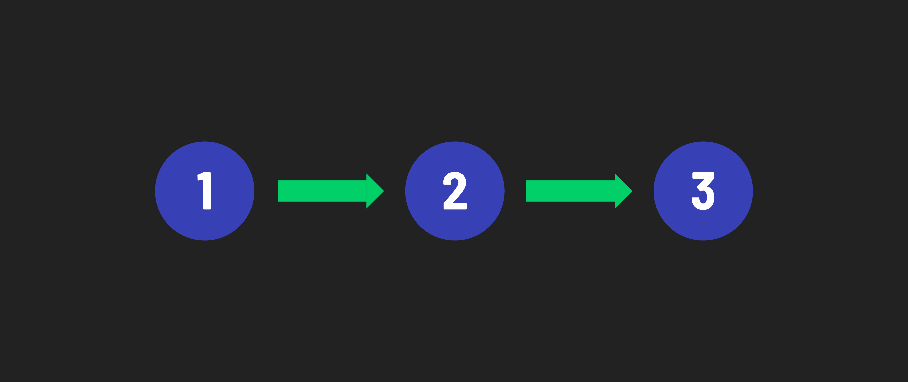
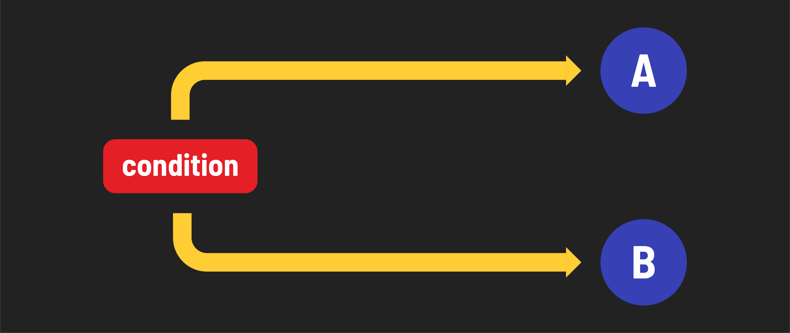
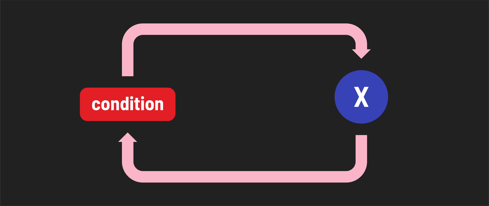
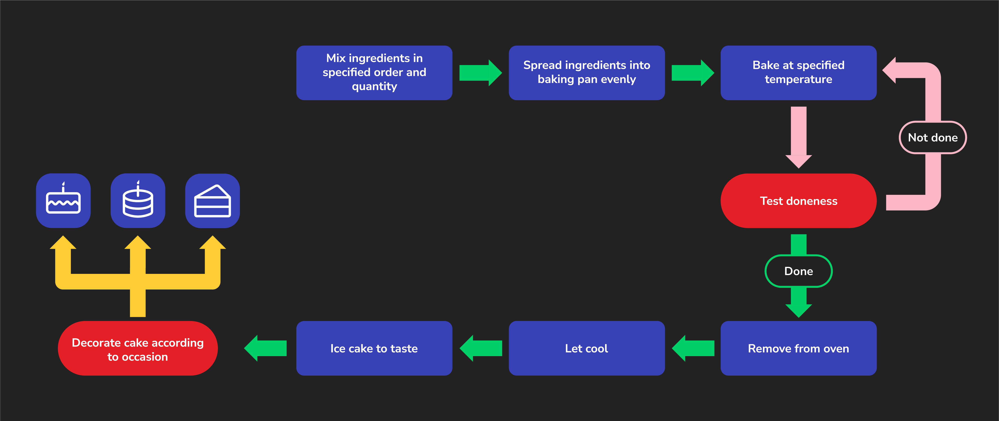

<h1>
  JavaScript Control Flow
  Concepts
</h1>

**Learning objective:** By the end of this lesson, you will be able to explain sequence, branching, and looping.

## What is control flow?

JavaScript usually runs code **from top to bottom**, one line at a time.

But programs also need to **make decisions** and **repeat actions**. **Control flow** is how we control which code runs and when.

## Three ways code can run

### 1. Sequence: run code in order

Each line runs after the previous line.

### 2. Branching: choose a path

A program can run different code depending on a **condition** (a question the program checks).

For example: *Is a product in stock?* If yes, show **Available**. If not, show **Sold out**.

### 3. Looping: repeat code

A **loop** runs the same code more than once.

For example: Show the numbers 1 through 5 without writing five separate `console.log()` statements.

## Putting them together

This picture shows all three ideas in one everyday activity. Follow the arrows: some steps happen in order, some require a decision, and some repeat.

## 🎓 You Do

For each example, choose **sequence**, **branching**, or **looping**.

1. A website displays a different message when a user is signed in.
2. A program prints each number from 1 to 10.
3. A checkout page calculates a total and then displays a receipt.

> 🧠 In this module, we will write branching code with `if` and repeating code with `for`.
