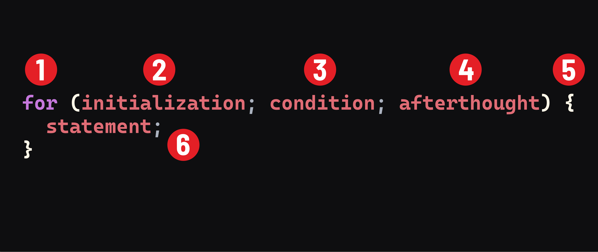

<h1>
  <span class="headline">JavaScript Control Flow</span>
  <span class="subhead">Looping</span>
</h1>

**Learning objective:** By the end of this lesson, you will be able to write a `for` loop to repeat code a set number of times.

## Why use a loop?

Suppose you need to print the numbers 1 to 5. You could write five `console.log()` statements. A **loop** lets you repeat the same action with less code.

```js
for (let number = 1; number <= 5; number++) {
  console.log(number)
}
```

Output:

```text
1
2
3
4
5
```

## Parts of a `for` loop



```js
for (let number = 1; number <= 5; number++) {
  console.log(number)
}
```
1: `for` - **`For` Keyword :** Tells JavaScript we're writing a for loop.

2: `let number = 1` — **Initialization (start):** Create a counter beginning at 1. This runs once.

3: `number <= 5` — **Condition (check):** Continue while this condition is truthy. JavaScript checks it before each repeat.

4: `number++` — **Afterthought (update):** Add 1 to `number` after each repeat.

5: `{ ... }` - **Statement :*** What we want our for loop to _do_.

The code inside `{}` is the part that repeats.

> 💡 `number++` is a short way to write `number = number + 1`.

## Follow the loop

| Repeat | Value of `number` | Is `number <= 5` true? | What happens? |
| --- | --- | --- | --- |
| 1 | `1` | Yes | Log `1` |
| 2 | `2` | Yes | Log `2` |
| 3 | `3` | Yes | Log `3` |
| 4 | `4` | Yes | Log `4` |
| 5 | `5` | Yes | Log `5` |
| Next check | `6` | No | Stop |

You can change the starting number or the ending number:

```js
for (let day = 1; day <= 7; day++) {
  console.log(`Day ${day}`)
}
```

> 🧠 The counter is often called `i`, but a name like `day` or `number` can be easier to read.

## Avoid infinite loops

A loop must eventually stop. If the condition never becomes falsy, the loop can run forever.

For now, make sure your update (`number++`) moves the counter toward the stopping point.

## 🎓 You Do

Write a `for` loop that prints the square of every number from **1 to 20**.

Expected output begins and ends like this:

```text
1 squared is 1
2 squared is 4
3 squared is 9
...
20 squared is 400
```

> 💡 To square a number, use `number ** 2`.
